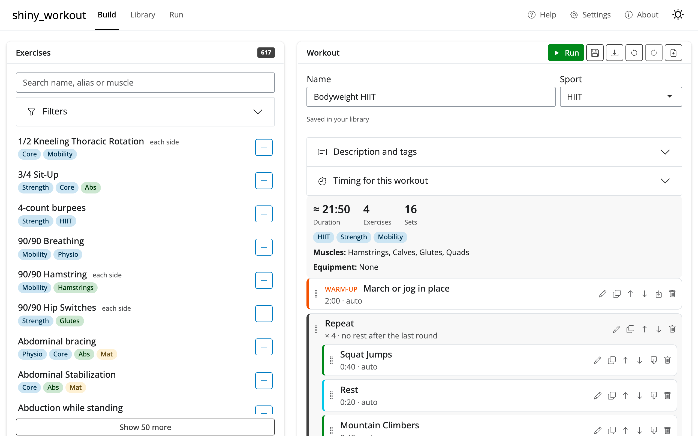
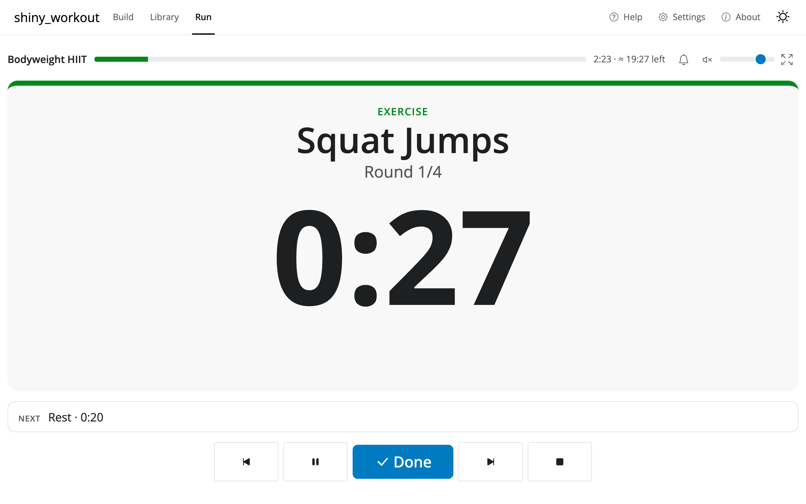
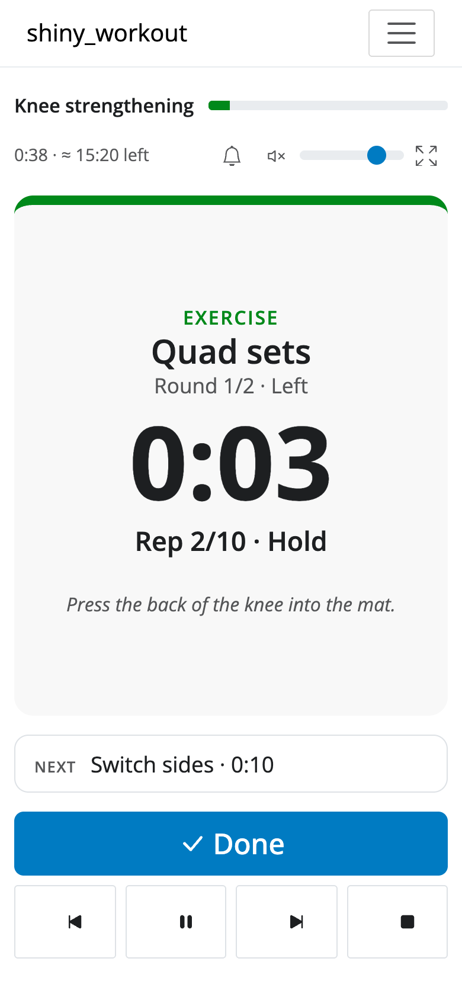
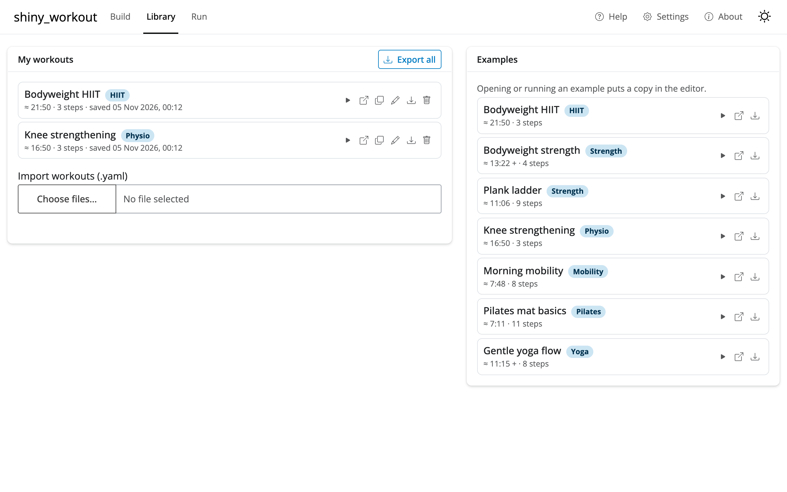

# shiny_workout

Build, save and run your own workout routines in the browser: bodyweight strength, HIIT,
planks, mobility, yoga, pilates and physiotherapy exercises.

**Open the app: <https://sinomem.github.io/shiny_workout/>**

It's an R Shiny app compiled to WebAssembly with
[Shinylive](https://posit-dev.github.io/r-shinylive/) and hosted on GitHub Pages. There is
no server: everything runs in your browser, and your workouts stay there.



## What it does

- **Exercise catalog** of about 600 exercises for home training (bodyweight, mat, ball,
  bands, foam roller), searchable and filterable by focus, equipment, muscle and level.
  Each exercise shows its instructions, source and license.
- **Workout editor**: exercise, rest, warm-up and cool-down steps, by reps or time;
  repeat blocks with rounds; each side (left, then right); guided reps for physio-style
  "10 × 5 s hold"; notes and weights. Drag to reorder, undo and redo. A summary shows
  the estimated duration, muscles worked and equipment needed.
- **Library**: save workouts in your browser, download them as YAML files, import them
  again (one at a time or a whole backup), and start from seven examples.
- **Player**: a large countdown readable across the room, "next up", progress and time
  left, beeps (softer for yoga, pilates and physio), optional voice, keyboard shortcuts,
  full screen, and a screen that stays awake. Timed steps move on by themselves, rep steps
  wait for Space. At the end you get a log with planned and actual time per step.

| Running a workout | On a phone |
|---|---|
|  |  |



## Using it

- The first visit downloads R and the app (about 30 MB) and takes a minute; later visits
  load from your browser's cache.
- Press <kbd>?</kbd> in the app for help. In the player: <kbd>Space</kbd> done / next,
  <kbd>P</kbd> pause, <kbd>←</kbd> <kbd>→</kbd> previous / next step, <kbd>Esc</kbd> stop,
  <kbd>F</kbd> full screen, <kbd>S</kbd> / <kbd>V</kbd> sound / voice.
- Saved workouts live in this browser's local storage. Clearing the browser's site data
  deletes them, so use **Export all** in the Library now and then to keep a backup file.
- The voice works best in Chrome. In Firefox on macOS it crackles at the end of every
  phrase (the beeps are fine).
- Physiotherapy exercises are general examples, not medical advice: follow your
  physiotherapist's prescription.

## Write a workout in YAML

Every workout is a small YAML file. The easiest start is to build one in the app, press
**Download**, and edit the file: catalog exercise ids are already filled in. Then import it
in the Library tab. A workout looks like this:

```yaml
schema_version: 1
name: Quick core
sport: strength
steps:
  - type: warmup
    name: March in place
    seconds: 60                  # counts down, moves on by itself
  - type: repeat
    times: 3                     # three rounds
    skip_last_rest: true         # no rest after the last round
    steps:
      - type: exercise
        exercise: fedb:Pushups   # a catalog exercise
        reps: 10                 # waits for Space
      - type: exercise
        name: Side plank         # or any name of your own
        seconds: 30
        sides: 2                 # left, then right
      - type: exercise
        name: Glute bridge hold
        reps: 8
        hold_seconds: 5          # guided reps: hold 5 s, relax, 8 times
      - type: rest
        seconds: 30
  - type: cooldown
    name: Stretch                # no target: runs until you press Space
```

The full format (every field, how steps advance, the settings a workout can override) is
in [docs/workout-format.md](docs/workout-format.md), and the examples in
[`app/workouts/`](app/workouts/) cover each kind of step.

## Development

Requires R 4.6. Package versions are pinned with [renv](https://rstudio.github.io/renv/).

```r
renv::restore()                 # install pinned packages
shiny::runApp("app")            # run the app with regular Shiny
```

Build and preview the static (WebAssembly) site:

```sh
Rscript scripts/build_site.R    # run tests, export to _site/
python3 -m http.server 8008 --directory _site
```

Then open <http://127.0.0.1:8008>. Shinylive needs a browser with service workers. The
page title, icon and loading screen around the app are in `scripts/site/`.

Pushes to `main` are tested, exported and deployed to GitHub Pages by
`.github/workflows/deploy.yml`.

The code is plain R (pure, tested functions in `app/R/`, thin Shiny modules around them)
plus a little hand-written JavaScript in `app/www/` for what needs to be instant in the
browser: the player's clock, keys and sounds, local storage and drag and drop. The plan
and design notes are in [PLAN.md](PLAN.md).

### Exercise catalog

`app/data/exercises.json` is generated; don't edit it by hand. Change the curated files,
`data-raw/vocab.yaml` or `data-raw/curation.yaml`, then rebuild it and `CREDITS.md`:

```sh
Rscript data-raw/build_catalog.R   # needs network on first run (pinned downloads)
Rscript data-raw/fetch_wger.R      # only to refresh the wger snapshot
```

### Screenshots

The images above are taken with headless Chrome by `scripts/screenshots.R`. It needs the
[chromote](https://rstudio.github.io/chromote/) package (not part of renv) and the app
running on port 8010.

## License

Code: GPL-3.0. The exercise catalog combines public-domain, MIT and CC-BY-SA sources and is
published under CC-BY-SA 4.0; see [CREDITS.md](CREDITS.md).
